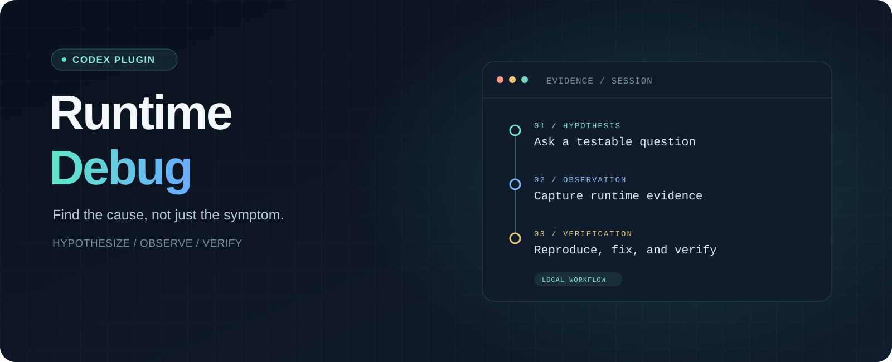

<p align="center">
  
</p>

<p align="center"><strong>Find the cause, not just the symptom.</strong><br>A local debugging plugin for Codex.</p>

<p align="center"><a href="README.md">简体中文</a> · <a href="#install">Install</a> · <a href="#how-it-works">How it works</a> · <a href="#privacy-and-safety">Privacy and safety</a></p>

<p align="center">
  
  
  
  <a href="LICENSE"></a>
</p>

---

Runtime Debug helps Codex investigate difficult bugs by forming testable hypotheses, adding temporary probes, collecting evidence from a real reproduction, and verifying the fix before cleaning up.

The plugin combines a Codex Skill with a local MCP server. The server collects and audits evidence; it **does not edit project files**. Codex makes any necessary edits using its existing permissions.

> **Candidate release.** Focused checks and isolated fixtures have been run on Windows with Node.js 22. An end-to-end investigation with a real user is still awaiting acceptance. The current Skill communicates in Simplified Chinese.

## Install

You need Windows, Node.js 22 or later on `PATH`, and a Codex client that supports plugin marketplaces. The current investigation scope is JavaScript/TypeScript in browsers and Node.js, and Python. Remote targets, macOS, Linux, and other languages have not been validated.

```powershell
codex plugin marketplace add glyahh/runtime-debug
codex plugin add runtime-debug@runtime-debug-marketplace
```

Start a new Codex chat and select **Runtime Debug**, or explicitly invoke `$runtime-debug`. Restart the desktop app if the plugin list has not refreshed. A prebuilt local MCP server is included, so installation does not require a build.

You can also install it from the **Runtime Debug** marketplace in the desktop plugin directory. Marketplace availability varies by client; see the [OpenAI plugin documentation](https://developers.openai.com/plugins/build/plugins).

### Install with an AI assistant

Copy this prompt to an AI assistant that can use your local terminal:

```text
Please install and enable the Runtime Debug Codex plugin on this Windows computer.
Source: https://github.com/glyahh/runtime-debug

Perform the installation and verification; do not just list the steps:
1. Check Windows, Node.js 22 or newer, and a Codex CLI that supports plugin marketplaces. Install missing dependencies from their official sources; explain any administrator approval or other action you need from me.
2. Check for an existing runtime-debug-marketplace. If it is not configured, run:
   codex plugin marketplace add glyahh/runtime-debug
   If the same marketplace name points elsewhere, explain the conflict before changing anything.
3. If the plugin is not installed, run the command below. If it is installed but disabled, enable it using a supported host mechanism:
   codex plugin add runtime-debug@runtime-debug-marketplace
4. Run codex plugin list --marketplace runtime-debug-marketplace --available --json and report the actual installation and enabled state. Do not assume a successful command means the host has loaded the plugin.
5. Explain how to select Runtime Debug or invoke $runtime-debug in a new Codex chat, and identify any restart or verification that is still needed.

Preserve other plugins and their settings. Do not change the model or permissions, run a debugging session, or upload local logs or project files.
```

## How it works

```text
Hypothesize → Add and register probes → Reproduce → Read evidence
    → Fix → Verify with a new run → User confirms → Clean up
```

Each run is isolated. Probe markers and fingerprints support precise cleanup, and a conflict is surfaced instead of overwriting other changes. An empty log is not evidence of a successful fix. After an interruption, the workflow audits existing probes before starting a new run; it does not replay the task automatically.

Tell Codex what happened, what you expected, and the shortest steps to reproduce it. The workflow waits for your reproduction and confirmation.

## Privacy and safety

- The collector listens on loopback, uses a separate token for each run, and requires exact browser origin allowlisting.
- Logs read by Codex become model context. Collect only necessary, non-sensitive fields: redaction of common keys cannot identify every secret.
- Python probes write directly to a local file. Validation and redaction happen when reading; the raw file may contain sensitive data and is not subject to HTTP ingestion limits.
- Sessions default to `%LOCALAPPDATA%\RuntimeDebug\sessions` and are not deleted on uninstall. Temporary probes and their tokens must be cleaned up after an investigation.
- The Skill guides the workflow; it is not a permissions sandbox. Codex remains subject to the host's existing access controls.

## Development

The source is in [`plugins/runtime-debug`](plugins/runtime-debug/):

```powershell
cd plugins/runtime-debug
npm ci
npm run build
```

The repository includes `dist/server.mjs` for installation. Update and verify it when changing the source. Probe templates are in [`references/probes.md`](plugins/runtime-debug/skills/runtime-debug/references/probes.md).

## License

[MIT](LICENSE). The bundled server's third-party licenses are listed in [THIRD-PARTY-NOTICES.txt](plugins/runtime-debug/THIRD-PARTY-NOTICES.txt).
