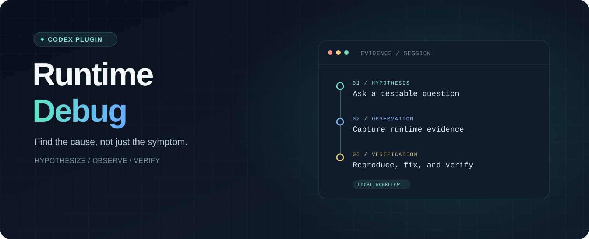

<p align="center">
  
</p>

<p align="center">
  <strong>让运行证据带路，找到真正的根因。</strong><br>
  一个面向 Codex 的本地调试插件。
</p>

<p align="center">
  <a href="#安装">安装</a> ·
  <a href="#开始一次调查">开始调查</a> ·
  <a href="#数据与安全">数据与安全</a> ·
  <a href="#开发">开发</a> ·
  <a href="README.en.md">English</a>
</p>

<p align="center">
  
  
  
  <a href="LICENSE"></a>
</p>

---

难以复现的问题，往往需要先弄清楚程序**实际发生了什么**。Runtime Debug 让 Codex 围绕可检验的假设添加临时探针，在用户复现后读取运行证据，再修复、验证并清理探针。

插件由一个 Codex Skill 和本地 MCP 服务组成。Skill 引导调查流程；MCP 服务负责采集、读取和审计，**不会自行修改项目源码**。需要编辑时，由 Codex 在现有权限内完成。

> **当前状态：候选版。** 已在 Windows 和 Node.js 22 上完成定向检查及隔离夹具验证；真实用户参与的完整问题调查仍待人工验收。现有 Skill 使用简体中文交互。

## 能做什么

| | |
| --- | --- |
| **用假设缩小范围** | 为每个假设选择观测点，用日志支持、排除或保留判断。 |
| **采集真实运行证据** | 通过临时探针观察浏览器、Node.js 或 Python 的实际执行路径。 |
| **区分修复前后** | 将基线和验证分为独立运行轮次，避免混淆旧证据。 |
| **让探针可追踪** | 登记标记与内容指纹；清理前审计，遇到冲突时不覆盖其他修改。 |
| **保留人工判断** | 等待用户复现和确认；正常完成需要验证证据与探针清理。 |

## 安装

**前提：** Windows 本地环境、可在 `PATH` 中找到的 Node.js 22 或更高版本，以及支持插件市场的 Codex。浏览器、Node.js 的 JavaScript/TypeScript 和 Python 是当前调查范围；远程目标、macOS、Linux 及其他语言尚未验收。

在终端中添加本仓库的插件市场并安装：

```powershell
codex plugin marketplace add glyahh/runtime-debug
codex plugin add runtime-debug@runtime-debug-marketplace
```

然后打开一个新的 Codex 聊天，选择 **Runtime Debug** 插件，或显式调用 `$runtime-debug`。如果插件列表没有更新，请重启桌面应用。仓库包含预构建的本地 MCP 服务，安装时无需自行构建。

也可以从桌面应用的插件目录选择 **Runtime Debug** 市场并安装。市场来源和安装行为可能因客户端版本而异；详见 [OpenAI 插件文档](https://developers.openai.com/plugins/build/plugins)。

### 让 AI 自动安装

将下面的提示词复制给能够操作本机终端的 AI 助手：

```text
请在这台 Windows 电脑上安装并启用 Codex 插件 Runtime Debug，来源：
https://github.com/glyahh/runtime-debug

请直接执行安装和验证，不要只列出步骤：
1. 检查 Windows、Node.js 22 或更高版本及支持插件市场的 Codex CLI。缺少依赖时使用官方来源安装；如果需要管理员授权或其他人工操作，请说明具体阻碍。
2. 检查是否已经配置 runtime-debug-marketplace。未配置时执行：
   codex plugin marketplace add glyahh/runtime-debug
   如果同名市场来自其他来源，先说明冲突，不要覆盖或删除现有配置。
3. 未安装时执行下列命令；已安装但未启用时，使用宿主支持的方式启用：
   codex plugin add runtime-debug@runtime-debug-marketplace
4. 使用 codex plugin list --marketplace runtime-debug-marketplace --available --json 核验安装与启用状态，并报告实际结果。不要把命令执行成功当作宿主已经加载插件的证明。
5. 告诉我如何在新的 Codex 聊天中选择 Runtime Debug 或调用 $runtime-debug；如果需要重启应用或仍有未验证的步骤，请明确说明。

保留其他插件及其设置，不更改模型或权限，不运行调试任务，也不上传本机日志或项目文件。
```

## 开始一次调查

在项目聊天中选择插件，描述现象、预期结果和最短复现步骤，例如：

```text
$runtime-debug

点击“保存”后页面有时显示成功，但刷新后内容丢失。
预期是刷新后仍保留修改。复现步骤：编辑内容，点击保存，然后刷新。
```

接下来，Codex 会与你一起完成这条流程：

```text
提出假设 → 添加并登记探针 → 你复现问题 → 读取证据
    → 定位并修复 → 用新一轮证据验证 → 你确认 → 清理探针
```

插件不会把空日志当成成功证据。验证未通过时应继续调查；异常中断后，会先审计遗留探针并创建新的运行轮次，不自动重放任务。

## 数据与安全

- **本地采集：** MCP 服务仅监听本机回环地址；每次运行使用独立令牌，浏览器来源必须精确列入允许范围。
- **日志进入模型上下文：** 读取的日志会随 Codex 上下文发送给所用模型。只采集必要、非敏感的字段；常见敏感键的脱敏不能保证识别所有隐私。
- **Python 原始日志：** Python 探针直接写入本地文件，校验与脱敏发生在读取时；原始文件本身可能含敏感信息，且不受 HTTP 写入限额保护。
- **证据与清理：** 会话默认保存在 `%LOCALAPPDATA%\RuntimeDebug\sessions`；卸载不会自动删除这些文件。临时探针及其令牌需要在调查结束后清理，插件不会回滚整个文件。
- **权限边界：** Skill 是工作流指导，不是权限沙箱。Codex 的项目访问与编辑仍受宿主现有权限控制。

## 开发

插件源码位于 [`plugins/runtime-debug`](plugins/runtime-debug/)。修改后可从源码重新构建：

```powershell
cd plugins/runtime-debug
npm ci
npm run build
```

`dist/server.mjs` 是仓库附带的构建产物；更改源码后，请一并更新并验证该文件。安装入口、探针模板和协议实现分别位于市场清单、[`references/probes.md`](plugins/runtime-debug/skills/runtime-debug/references/probes.md) 和 [`src`](plugins/runtime-debug/src/) 中。

如果插件无法启动，先检查 `node --version`；如果没有日志，检查应用是否加载了带探针的最新资源、是否走到了对应执行路径，以及采集是否出错。不要把手工发送的请求当成业务探针已执行的证据。

## 许可证

本项目采用 [MIT 许可证](LICENSE)。预构建文件包含的第三方软件及其许可证见 [THIRD-PARTY-NOTICES.txt](plugins/runtime-debug/THIRD-PARTY-NOTICES.txt)。
